<p align="center">
  <a href="https://aarxa.github.io/loka/">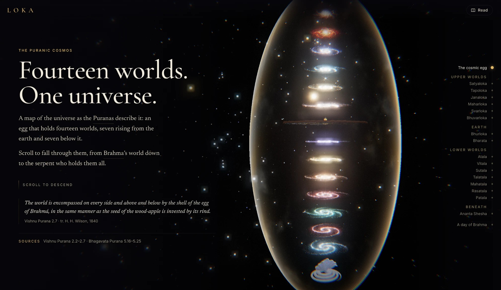</a>
</p>

<p align="center"><b>An explorable universe of Hindu mythology.</b><br>
Fall through the fourteen worlds of the Puranas, from Brahma’s world down to the serpent who holds them all.</p>

<p align="center">
  <a href="https://aarxa.github.io/loka/"><b>Open the live site</b></a> &nbsp;·&nbsp;
  <a href="https://aarxa.github.io/loka/media/loka-film.mp4"><b>Watch the film</b></a> &nbsp;·&nbsp;
  <a href="https://github.com/aarxa/loka/releases/tag/film-v1">Download it</a>
</p>

# Loka

You travel through a 3D cosmos of the fourteen worlds of the Puranas, and each world opens into sourced, scroll-driven stories. Created by Aarya Rajgor.

*Loka is a working title. This is an early prototype.*

## The film

<a href="https://aarxa.github.io/loka/media/loka-film.mp4">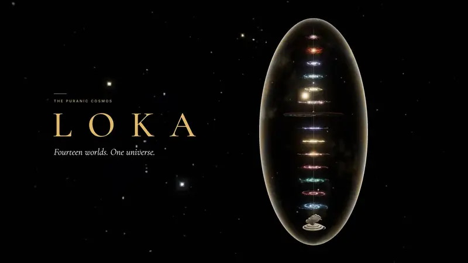</a>

A 77-second flight from the cosmic egg down through every world to Ananta Shesha, then back out through the egg. It was rendered frame by frame from the site itself at 4K, with a tanpura-style drone made for it. [Watch it](https://aarxa.github.io/loka/media/loka-film.mp4), or [download it in 1080p](https://github.com/aarxa/loka/releases/tag/film-v1).

## The worlds

| | |
|:---:|:---:|
| 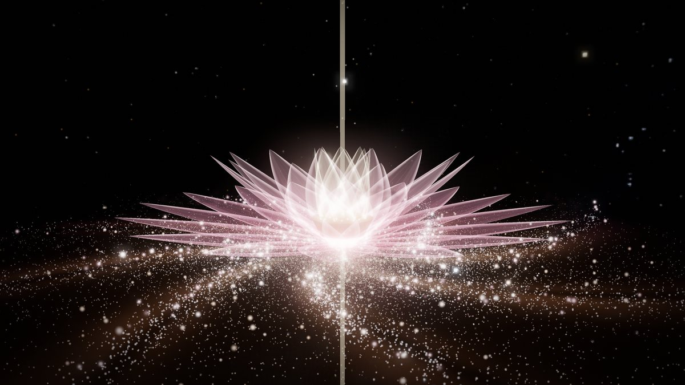<br>**Satyaloka.** The world of Brahma, highest of all. | 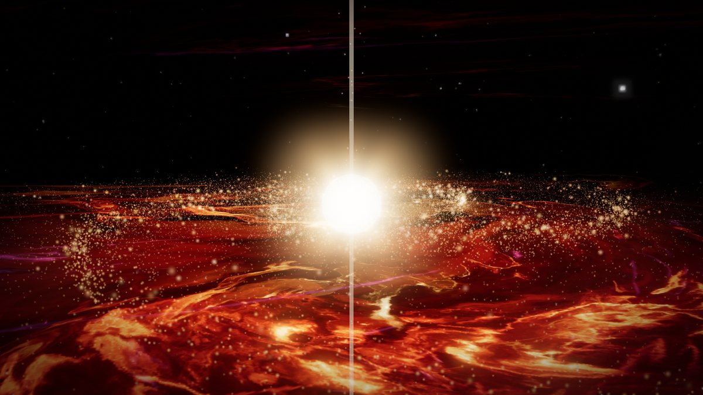<br>**Tapoloka.** Home of the gods the fire that ends the world cannot burn. |
| 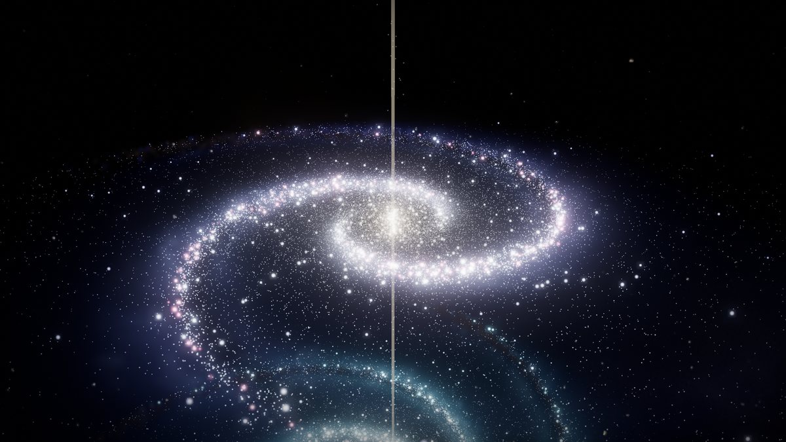<br>**Janaloka.** Home of the mind-born sons of Brahma. | 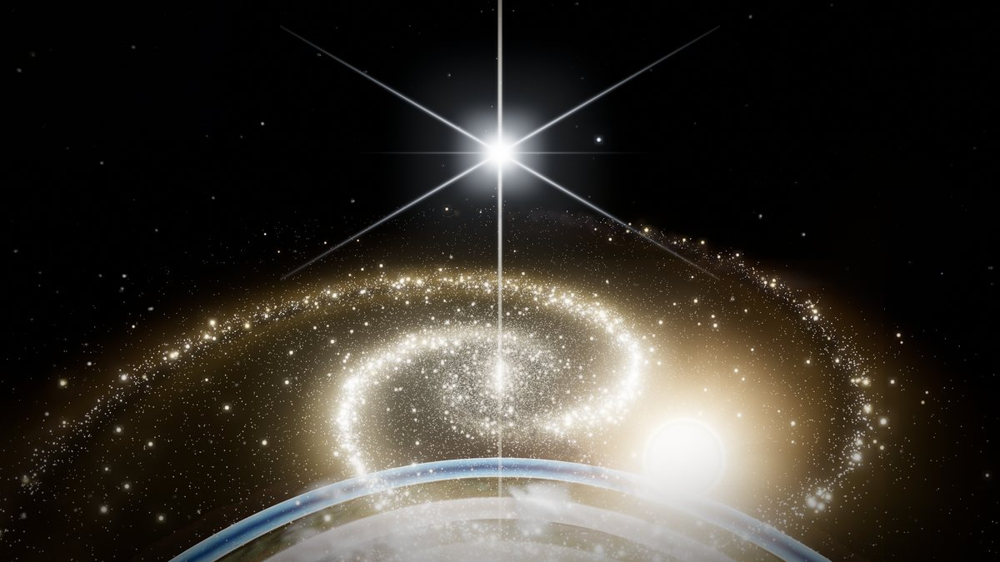<br>**Svarloka.** Indra’s heaven, reaching from the sun to Dhruva, the pole star. |
| 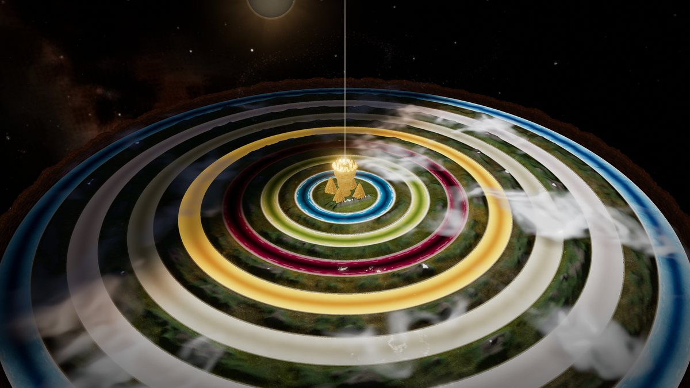<br>**Bhurloka.** The earth as a lotus: Meru at the centre, seven continents ringed by seven seas. | 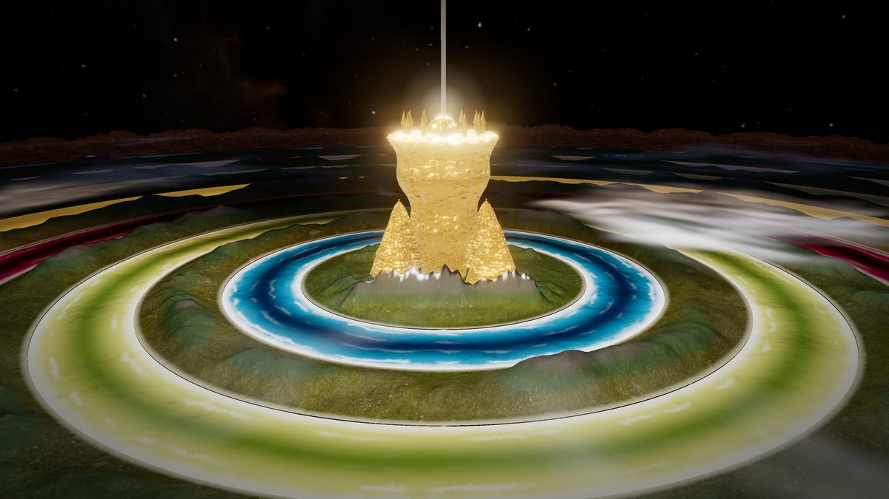<br>**Mount Meru.** Wider at the summit than at the base, with Jambudvipa round it. |
| 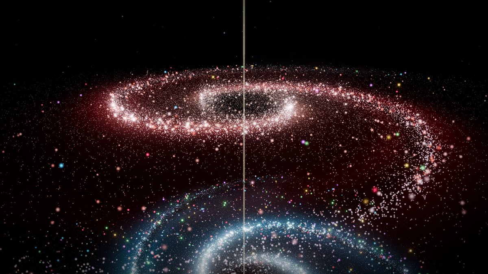<br>**Rasatala.** The fortress of the Daityas and Danavas. | 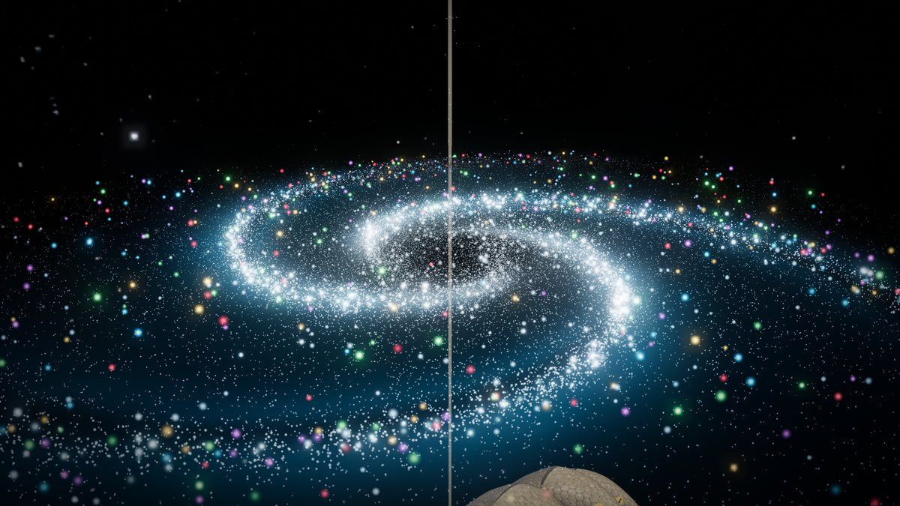<br>**Patala.** The world of the nagas, lit by the jewels on their hoods. |
| 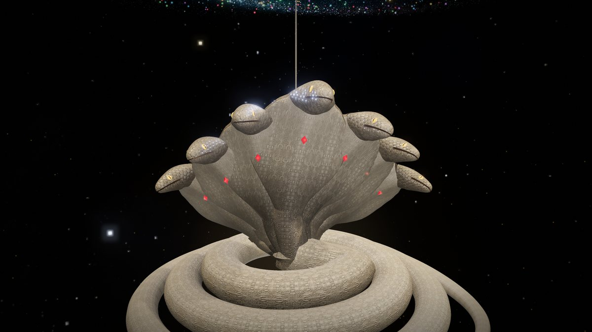<br>**Ananta Shesha.** The endless serpent beneath all the worlds. | 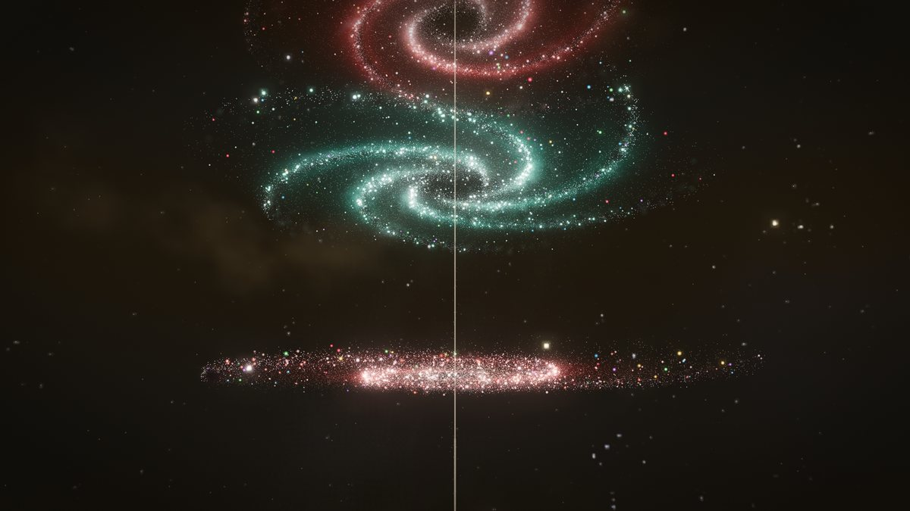<br>**From below.** The worlds stacked up the cosmic axis. |

## The site

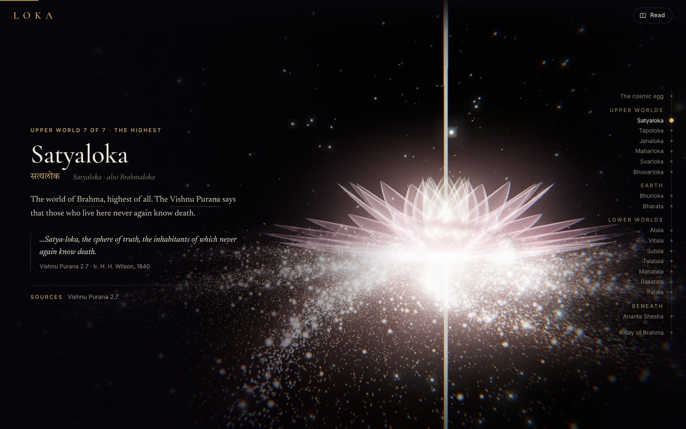

Each world comes with its text, its sources and quotes from public-domain translations. The rail on the right jumps between worlds, and **Read** opens everything as plain text.

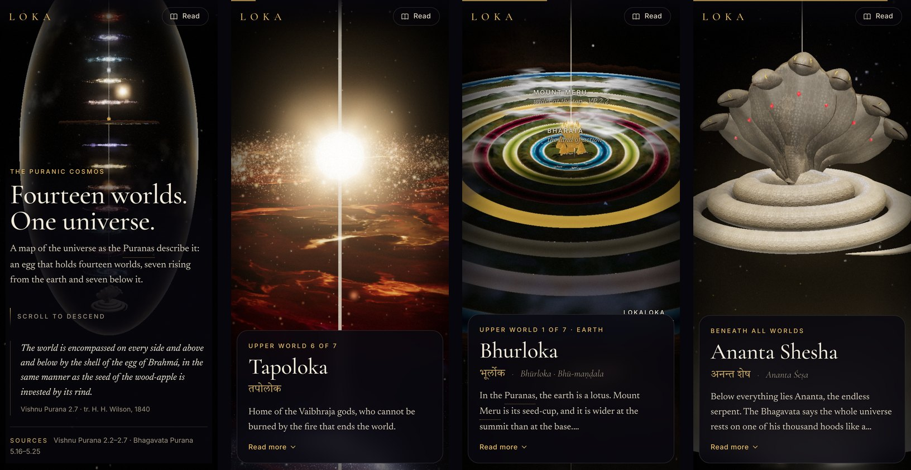

On a phone, each world’s text sits in a card under the scene.

## How it’s made

- **Plain web code:** three.js and plain ES modules, with no build step.
- **Living galaxies:** each gas world is a density-wave galaxy. Its stars, gas and dust follow their own orbits, and the spiral arms hold their shape while everything flows through them.
- **Tapoloka’s fire:** painted once at load into high-resolution textures from layered noise. The same fire fills the world as a volume of gas the camera flies through, with wisps that stream past and sharp sheets for the view from above, round a burning star.
- **The earth:** day and night follow the sun as it circles Meru. There are mountain ranges, clouds that cast shadows, and seas with swell and surf.
- **The camera:** scrolling flies it along a path through the worlds. The top worlds each have their own moving shot.
- **The film:** rendered one frame at a time from the site at 4K, then encoded with the Mac’s hardware video encoder. The tools are on the `film-kit` branch.

## Run it

Serve the folder and open it in a browser:

```bash
python3 -m http.server 5173
```

Then go to <http://localhost:5173>. The page needs a server: browsers won't run its scripts straight from a file, so opening `index.html` from disk only shows a note saying so.

## What's here

| Path | What it is |
| --- | --- |
| `index.html` | The cosmos homepage's markup: header, rail, footer, and where the scripts load |
| `css/loka.css` | All the page's styles |
| `css/fonts.css`, `fonts/` | The four typefaces, served from the repo, with their licences |
| `js/content.js` | The words: every world's text, sources, Versions notes, read mode's notes, and where the camera goes for each |
| `js/page.js` | The page: builds each world's text, the rail and read mode, and turns scrolling into a camera path |
| `js/cosmos.js` | The 3D scene: the night sky, the egg, the fourteen worlds, Mount Meru and Ananta Shesha |
| `js/galaxy.js` | A world as a living galaxy: stars on their own orbits, with gas, star-forming knots and dust along spiral arms that hold their shape while everything flows through them |
| `js/nebula.js` | A world of living fire (Tapoloka): sharp flame and smoke painted once at load in high detail, filling the world as a ray-marched volume of gas, wisps and sheets round a burning star |
| `vendor/three/` | three.js 0.160.0 and the add-ons the scene uses |
| `assets/sky/` | The real night sky (NASA star map) and the 7,000 brightest stars taken from it (`stars.bin`, packed from `stars.json`) |
| `assets/tex/` | Textures for the oceans, continents, Meru and Shesha |
| `assets/models/` | Shesha's hooded heads |
| `tools/` | Scripts that made the processed assets |
| `media/` | The web version of the film and the images in this README |

Everything is served from the repo, with no build step: the scripts are plain ES modules.

## Working on it

`main` is the working version. New work goes on its own branch and comes back into `main` through a pull request.

In progress on their own branches:

- `narasimha-saga`: the first story, being improved before it goes live
- `puranic-sky`: Dhruva, the seven sages, the 28 nakshatras and the Shishumara, drawn over the real stars
- `time-dial`: the parked time dial for the four ages, kept as it was before the code was split into files
- `film-kit`: the tools that render the film, stills and screenshots from the site

## Credits

- **Texts:** read online in [H. H. Wilson’s Vishnu Purana](https://sacred-texts.com/book/the-vishnu-purana), the [Bhagavata Purana](https://vedabase.io/en/library/sb/) and [Bhagavad Gita](https://vedabase.io/en/library/bg/) (Bhaktivedanta Book Trust), [K. M. Ganguli’s Mahabharata](https://sacred-texts.com/categories/mahabharata) and [R. T. H. Griffith’s Ramayana](https://sacred-texts.com/book/ramayan-of-valmiki).
- **Sky:** [Deep Star Maps 2020](https://svs.gsfc.nasa.gov/4851), NASA/Goddard Scientific Visualization Studio (from Hipparcos-2, Tycho-2 and Gaia DR2).
- **Land and rock textures:** [aerial_grass_rock](https://polyhaven.com/a/aerial_grass_rock) and [cliff_side](https://polyhaven.com/a/cliff_side), Poly Haven, CC0.
- **Water normals:** [three.js](https://github.com/mrdoob/three.js) example texture, MIT.
- **Shesha's heads:** ["King Cobra"](https://sketchfab.com/3d-models/king-cobra-a8dab84cd4fc428bbcfe194e3ac14d06) by Anthony Yanez, [CC BY 4.0](https://creativecommons.org/licenses/by/4.0/). Cut to the neck, hood and head, smoothed, and its skin retinted.
- **3D engine:** [three.js](https://threejs.org), MIT, served from `vendor/three/`.
- **Typefaces:** Cormorant Garamond, Newsreader, Inter and Tiro Devanagari Sanskrit, SIL Open Font License, served from `fonts/` (licences included).

## Source files not in the repo

The original downloads are left out to keep the repo small. Fetch them again from the links above if you need to rebuild the processed assets:

- `assets/nasa-starmap/starmap_2020_4k.exr`: the 4K star map from NASA SVS 4851
- `assets/_downloads/`: the 2K Poly Haven textures, the three.js `waternormals.jpg`, and the King Cobra glTF

## License

**All rights reserved.** © 2026 Aarya Rajgor. You're welcome to visit the site and look through this repository. You may not copy, modify, redistribute or reuse any part of it, code or media, without written permission. That includes using it to train AI models. See [LICENSE](LICENSE).

The third-party material listed under Credits keeps its own licenses.
